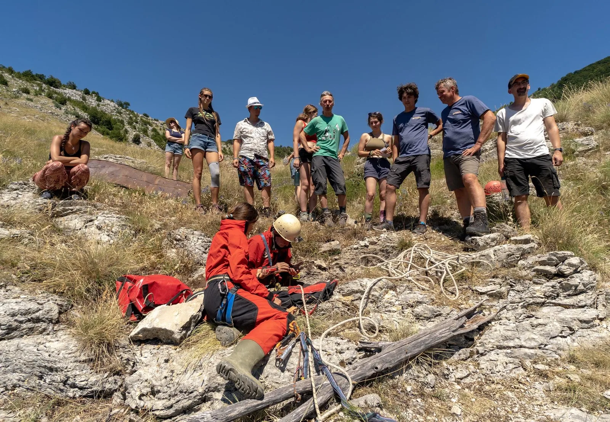
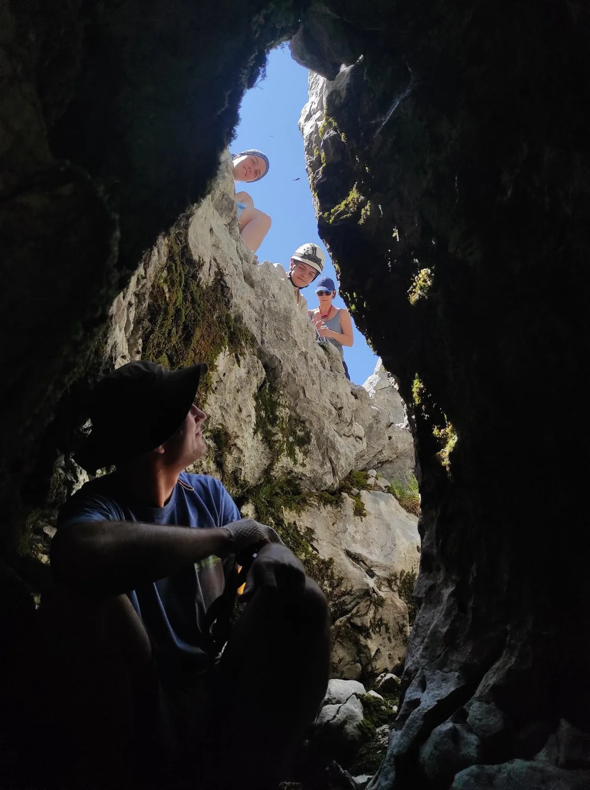

<!-- PDF page 1 -->

Nagysikerű alapfokú tanfolyamot tartott az FTSK idén amin nem telt el nap, hogy ne
emlegette volna valaki Njegusit és Montenegrót. A Njegusi nevet senki se tudta
megjegyezni, szóval mindenkinek Montenegró égett be a tudatába mint a barlangászok
Eldorádója - a hab a tortán, amiért érdemes a főellenség elhúzásokat is leküzdeni.

Nagyon
lassan de elérkezett az indulás napja. Kocsi lemosva, lámpák feltöltve, slósz bepakolva,
szendvicsek megkenve, laptop lecsukva. Menjünk már!

A csapat nagy része Gebéék vezette konvojban indult meg péntek éjjel és egy rövid határ
menti sátrazás után hajnalban vágott neki az út érdekesebb részének. Ami kevésbé volt
érdekes mint vártuk. Fel voltunk készülve úton bóklászó állatokra de csak egyszer kellett
teheneket kerülgetni.

A Tara folyón átkelés fantasztikus, “Welcome to Crna Gora!”. Suhanás
Niksic mellett (ekkor még nem tudtuk milyen sokat köszönhetünk ennek a településnek),
körforgalmazás Podgoricában és bevásárlás Cetinjében után érkeztünk meg a
Njeguši-poljébe.

Alig 100 métert tettünk meg a völgyben amikor elkövettünk az első súlyos
hibánkat, nem álltunk meg a Bukovinán italozgató társakat látva. Kezdő hiba, nem fordul elő
többet, ti se kövessétek el.

A táborba megérkezve már álltak a budik és a központi sátor, hűltek a sörök és a jedi tanács
is elfoglalta a helyét. A TBEsek meg a nekünk tartott helyet foglalták el az árnyékos részen,
mind1, egy kőkupac lábánál állítottunk fel a sátrainkat. Itt a tapasztaltabb társak egyből
kiképzetek minket, hogy kell a sátrakat becipzározni, hogy ne tojjon bele a skorpió. Általában
a sátramnak közelébe se jönnek nőstények szóval nem aggódtam túl, 2 skorpiót láttunk a
hét folyamán de békések voltak.

Álltak a mi sátraink is jöhetett a jól megérdemelt Niksicko.

Az este csúcspontja a Speleo Blikk első számának megjelenése volt. Bárhova néztem
mindenhol a kiadvány felett kacagó embereket láttam, ennek tuti lesz folytatása.

Az első nap egy hosszabb eligazítással indult, ezek a “termelési értekezlet”ek kb mint az
agilis módszertan daily standupjai. Mindenki (minden csapat) elmondja mit csinált előző nap,
mit fog csinálni ma, milyen feladatokra kell ember, milyen túrákhoz lehet csatlakozni.

Első nap a csapatunk kisebbik része a KARRnevál-barlangba ment egy tavalyi találatot
ellenőrizni a nagyobb része pedig a Hideglelős-barlanghoz segített felserpázni a kutatáshoz
szükséges felszereléseket majd célba vette a tengerpartot. Ahogy jövünk vissza a barlangtól
arra leszünk figyelmesek, hogy 2 piros overálos figura vesz körül egy lyukat egy meg már
derékig benne. “Itt volt az a vaslap a lyukon, hogy ne essenek bele a tehenek. Megnézzük!”

<!-- PDF page 2 -->

Irány a tengerpart! Ilyet még sosem láttam: a tengerpartra menet a navigáció azt írta, hogy
915m tengerszint feletti magasság és úgy nézett ki az út mintha egy 2 éves zsírkrétával
színezte volna. A kotori szerpentin eszméletlen, bömbölt az eurobeat, az út többi részét
szeretnénk elfelejteni. A csobbanás jól sikerült, megnéztük még este Kotort ahol egy profi
idegenvezető (Tóth Attila) kalauzolt bennünket.

**Második nap** felszíneztünk ami azt jelenti, hogy a karsztmezőn mászkálva be kell kukkantani
minden lyukba hátha van ott valami. Nagyon tetszett ez a sziklákon mászkálás de arról
egész nap fogalmam se volt mekkora lyukakat is keresünk.

Bekukkantottam minden résbe,
ahova a kezem befért erre hazaindulás előtt szól valaki, hogy gyertek találtunk valamit. Oda
még a kombínó is befért volna -.-

Első nap nem találtunk ígéretes barlangot de mi lenne
ebben az érdekes, ha mindenkinek menne elsőre, legközelebb! Este elmentünk megnézni a
naplementét a Kotori-öböl fölött majd rottyolás a központi sátor alatt és eszméletlen
masszírozás partik mindenfele.

**Harmadik nap** a Nyúl-lika-barlangot vettük célba de reggel még feladatunk volt ivóvíz hozása
Bukovináról amit Pepe megmutatott, hogy működik meg összehaverkodtunk Gyuróval a
kocsmárossal akinek nagyon tetszett a lajtos kocsi.

Víz a táborban irány a barlang! Egy kis
kitérővel. Gyovai Tomi megmutatta az Anna-barlang bejáratát és a Jeges-Kétlyukú
környékén felszíneztünk egy kicsit.

A barlang fantasztikus volt, 150 méter mélyre mentünk le
a cseppkőkapu nevű képződményig ami 48 métert vert az előző rekordunkra és azért
emlékezetes mert ekkor másztam először magasabbra mint a MOL torony (143m) amin a
tanfolyam idején munkába menet nézegettem, hogy a hétvégi túrák 60-80-100 méteres
barlangjai mekkorák is ha mellé képzeli az ember. Különlegessége volt még a túrának, hogy

<!-- PDF page 3 -->

Nyúlné Helga is velünk jött aki férjével (a barlang névadójával) évekig kutatta ezt a barlangot
és minden kőhöz, megosztáshoz tudott egy történetet mondani. Először másztam pantinnal
ami nagyon megtetszett, csak ajánlani tudom a kipróbálását. Jajaja és Njegusi sonkát ettünk
a végponton ami nálunk maradt a reggeli kapkodásban. Rohadt finom de nem jó barlangi
kaja mert sokat kell rágni és nagyon sós.

<!-- PDF page 4 -->

**Negyedik nap** felszíneztünk sajnos barlang ebből se lett de megnéztünk új ígéretes
területeket is. A legjobb lyukban volt egy tank lövedék, ezt bejelöltük a térképen és
menekültünk. Meg volt egy nagyon jó törmelékes rész ami alól süvített ki a hideg levegő és a
hozzáértők szerint “Magyarországon ezt már bontanák!” de nem álltunk neki.

**Ötödik nap** is mi voltunk a sorosak ivóvizet hozni, másodjára már megoldottuk alapfokúsok,
hagytuk Pepét aludni.

Montenegró egyik nevezetességét a Shkodrai-tavat vettük célba ami
kb egy óra kocsikázásra volt a tábortól ha a tapasztalt kollégákat követte az ember. Ide is
nagy segítség volt, hogy nem egyedül kellett oda találni hanem konvojban mentünk.

A tó
gyönyörű, a csónakázás és fürdőzés nagy flash. A szépek és a gyerekek és Sági papa
kaptak virágot és kalapot vizililiomból. A tóparton még kellemesen bekajáltunk és
tequiláztunk (az utasok) és életem legjobb hangulatú haza útján végre kipróbáltuk a
hangrendszert a kocsiban.

**Hatodik nap** a csapat nagyobbik fele felszínezni ment és talált is barlangot amit
Álomcsehtlen-nek neveztek el mert itt még nem járt a 80as évek cseh expedíciója akiknek a
nyomait sok addigi ígéretes lyukban felfedeztünk.

Én a Baritosokhoz csatlakoztam akik
szívesen vittek egy alapfokúst az előző nap talált barlangjuk térképezésére. Kipróbálhattam
a distóval mérést, vertem a követ kalapáccsal, Szabó Gergő tanította a skacokat megosztást
befúrni. A legjobb sztori az volt amikor Barna aki a térképet rajzolta mondja, hogy

- Mérj már be ide az omladékba, hogy milyen mély.
- 12 méter.
- 12? Ne viccelj, az nem lehet.
- 12! Nézd, hova lemegy a lézer!
- Tényleg. Király, itt lesz valami!

És volt is! Az az akna amit a másik oldalról egy rés tágításával próbáltunk elérni. Amíg
ütöttem a követ a rés körül a többiek rugdosták le az omladékot nagy versenyben merről
lesz a jó bejutás. Végül felülről lett meg, Peti befúrt egy nittet és gyerünk, itt még senki se
járt előttünk!

Sajnos engem nem engedtek bemenni mert nagyon omladékos maradt
továbbra is amit nagy csalódás volt hallani másfél óra reménykedés után de tökéletesen
indokolt.

A Dunning–Kruger-hatás ugrott be, hogy de messze vagyok bármiféle
hozzáértéstől. A barlangot Aranyfüstösnek neveztük el a bejárati szakaszban növő mohákon
összegyűlt páracseppekben játszó fény után. Kifelé jövet először szerelhettem ki barlangban
és hoztam ki baget. Jajajaja fontos, hogy Armytek lámpával nem lehet distózni, a mágneses
csatlakozó összezavarja a műszert.

**Hetedik nap** is a tengerpartra mentünk és beúsztunk a víz alatt egy barlangba ami életem
legparább élményei közé került be. Csak jó tüdejű, jó úszóknak ajánlom miközben a társai
nagyon odafigyelnek mi történik.

Este bementünk még Kotorba de csak néztük a vizet és a
hét kalandjain és a másnapi hazaúton törtük a fejünket.

**Második héten** már nem vettem részt de biztos vagyok benne, hogy legalább ilyen kalandos
volt a skacoknak akik maradtak. De ez már más történet, és elbeszélésére más alkalommal
kerül majd sor.

## TLDR:

Fantasztikus a montenegrói kutatótábor mindenkinek csak ajánlani tudom mert egy
hét alatt végigkövetheti a barlangkutatás teljes folyamatát onnantól, hogy rés a karsztmezőn,

<!-- PDF page 5 -->

odáig, hogy ez a hosszmetszet fog bekerülni a nemzeti park adatbázisába.

Láthat gyönyörű
barlangokat ahol olyan emberek kalauzolják akiknek minden szavából tanulni lehet. És a
tengerről meg a lazulásról se kell lemondani.

Köszi a szervezést és a kalandokat! Jövőre ugyan itt ugyan veletek! A Tábor-barlangban
elrejtettünk egy kis meglepetést a jövő évre, azé aki előbb odaér!

u.i.: Hajtsátok le a budi fedelét!
