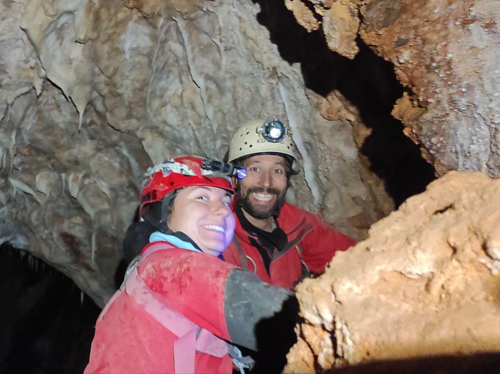
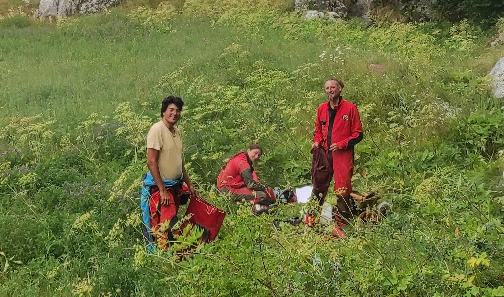
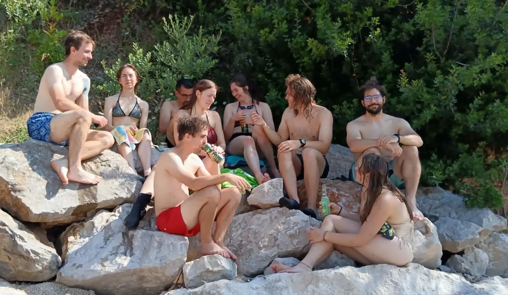
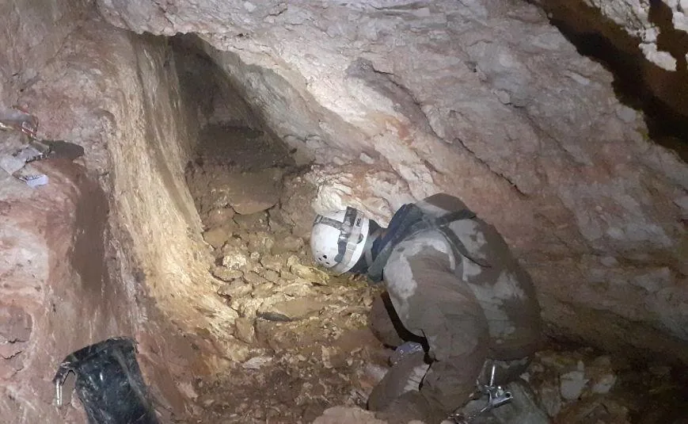
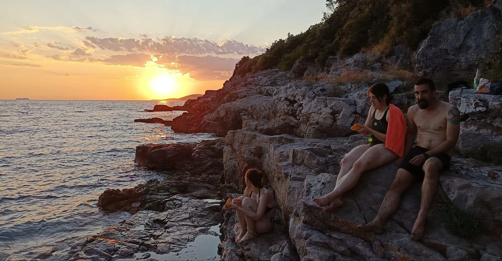

<!-- PDF page 1 -->

2 éve úgy címeztem az élménybeszámolómat, hogy "FTSK alapfok does Montenegró", ez a
brigád mostanra eltűnt. Utolsó mohikánként készültem a táborra, kicsit fejvakargatva, hogy a
niksicko lesz az egyetlen támaszom.

Szerencsére az akkor írt bevezető mondat, hogy
"Nagysikerű alapfokú tanfolyamot tartott a..." most a CK-ra volt igaz: sok jóarc, lelkes
barlangászt termelt ki a klub akikkel tudtam rovarkodni.

Fő célom is egybeesett velük:
erősödni, ügyesedni, gyakorolni az őszi T2 tanfolyamra, hárman is jönnek majd a Cave
Kidsből. Harmadszorra levezetni már rutin volt: Laura, Nyúl Dóri és Gomba voltak az
utasaim, 5 csillagot kapnának ha uber sofőr lennék. Hajnali indulás és érkezés sötétedés
előtt, határoknál mákunk volt.

## Vasárnap:

Nyúl-lika beszerelés, nem is akárkikkel maga Nyúl, Nyúlné Helga, Balázs Viki,
Acca és Laller vettek be a beszerelő csapatba.

Nem kapkodtuk el, belefért egy védőital
Bukovicán előtte, majd fel a hegyre a mobil-tornyos hajtűkanyarból. Odafele menet Nyúl
még talált valami lukat aminek a koordinátáit felírtuk.

Viki hozott UV lámpát amivel
megnéztünk egy csomó képződményt, menő cucc.

A beszerelést rutinosan megcsinálták a
skacok és még elmentek megnézni valamit amíg Helgával kifelé indultam de a bejárati
aknában simán utolértek.

Két éve már voltam ebben a barlangban -150 méteren a
Cseppkőkapunál, akkor ez lett a legmélyebb pont ahol életemben jártam. Most 300m mélyre
jutva megint ebben a barlangban van ahol legmélyebbre jutottam. A kataszter szerint 400m
mély a barlang de Laller azt mondta jövőre megyünk 500m-re (2027 egy/két napra megvan
a program). Jó hosszú túra volt, asszem utolsóként értünk vissza a táborba.

<!-- PDF page 2 -->

## Hétfő:

A nap sztorija még az FTSK-Myotis evezésen indult, mondtam Gyovai Tominak, hogy
ez lesz a harmadik Montenegróm, vegyenek be valami keményebb veretésbe. Az ajánlott
program keménysége leszaladt a Mohs skáláról: a Jeges barlangban (ahol még nem jártam)
a bejárattól indulva eltúrázni az inverz deltáig és kijönni (még senkinek sem sikerült).
Ott
megnézni egy továbbjutást ami egy tóban úszva (garantált kihűlés) kezdődik. És ehhez
nekem kell a csapatot összeszedni (lerázni szoktak).

Mission impossible de gyerünk, lets go,
los gehts, vamos, jalla, davaj! A csapatot végül Tomi összeszedte: Balázs Viki, Kagyó és
Dömök Dávid voltak a túratársak.

Kagyóval most voltam először túrázni, a nevet nem kellett
bemutatni de, hogy tankönyvi túravezető az elképesztő, ilyet életemben nem láttam. Hogy
ezt érzékeltessem bevezetek egy “tankönyv számlálót”. {1} indulás előtt megkérdezte, hogy
“mindenki alkalmasnak érzi magát fizikailag, mentálisan?”. {2} Csináltunk társellenőrzést.

Aknasoron le Heni T2 vizsga beszerelésén, menő pálya volt, szép munka. Hal-álom
kuszodán át el a bivak mellett a Ryobiológia-ágba.

{3} “akkor lehet a leggyorsabban haladni
ha csak a talpunk ér a barlanghoz” élő bemutató: ahol én a meander fölött kilenc végtaggal
kapaszkodtam (kezek, lábak, térdek, fülek, segg) mindenbe, Kagyó úgy sétált mintha a
körúton lettünk volna. Haladt az tuti, nem győzőtt {4} hátra nézegetni, hogy hol vagyok.

Elértük az inverz deltát! De az, hogy ott tóba fetrengjek az esélytelen volt, ki is kell menni! A
baszó túra összejött, barlangkutatáshoz kevés voltam. Ábrissal, aki kimászta a továbbjutást,
már dumáltam azóta, hogy majd jövőre. (2027 egy/két napra megvan a program)

Viki meg
Kagyó kiszereltek pár kötelet, Dáviddal eszegettünk meg körbejártuk a helyet, de a fő
szempont ekkor már az erőgyűjtés volt a kijutáshoz. Kifelé jövet egyszer csak kérdi Kagyó,
hogy {5} “Figyeled a mögötted jövőt?” Én: “őőőő Dávid megvagy?” Dávid: “őőőő hát most itt
egy kicsit megszorultam”. Tudta. De honnan? Hogy? Varázslat.

Bekukkantottunk a bivakba
ahol a skacok már javában foglalták el a táborhelyet. Lediktálták mit rágott szét a pele és kell
egy csapatnak hoznia másnap.

Ki a hal-álomon, az aknasorban utolértük a transport
csapatot amiből szeretném kiemelni Barbi és Kolos kollégákat akik alapfokúsként bevállalták
a bag cipelést, én még tavaly se mertem T1 küszöbén. Harmadévesként se sikerült
segítenem a Jeges kutatást, nekik meg már az elsőn, le a kalappal. Hazafele megnéztük a
kivilágított Kotor panorámáját. Jó hosszú túra volt, asszem utolsóként értünk vissza a
táborba ahol ki lettem mentve {6} célok és lehetőségek dumával.

<!-- PDF page 3 -->

## Kedd:

A feladat adott volt, visszamenni a Jeges bivakba a kért cuccokkal de nem éreztem
magamban az erőt hozzá. Jövőre kanossza járásként tuti becsatlakozok a transportba (2027
egy napra megvan a program).

Helyette a tengerpartot vettük célba. A tengeralattjáró
bázisos partra mentünk: Laura, Solyesz és Ági voltak az utitársaim meg összeverődtünk
még 2 kocsinyi emberrel akik elsőbálozók voltak a kotori szerpentinen. Fantasztikus volt a
tenger meg a csapat, erre volt szükségem.

De ami a táborban fogadott! Katzer hozott egy
gázpalackos vízmelegítőt, 2026ban megérkezett a meleg zuhany Montenegróba! Tusolás
után egyből mentem hozzá megköszönni egyszál törölközőben.

<!-- PDF page 4 -->

## Szerda:

2025-ben katasztrófálisan végződő munkahelyváltás, katasztrófálisan végződő
Myotis tanfolyam, bukás a T1 vizsgán voltak a közelmúlt eseményei amikor megindultam
Montenegróba. Erre első nap az első hullám elvitte a szemüvegem, majd egyik nap
megzúztam a kocsi orrát.

Rossz szériában voltam, jó lelki gyakorlatnak tűnt, hogy 3 napig
ástam az “átvágás a majom-folyóhoz” feltőltődött szifont a Szent János-barlangban. Az
átvágás nekem nem, de Frank Máténak 10 perc alatt meglett végül tavaly.

Ezekkel az
emlékekkel tértem vissza a Szent János-barlangba Csaszi, Gábor és Kinga társaságában
ahol egy kürtőmászás volt az aktuális project. Gábor mászott, Csaszi biztosította, Kingával
addig megnéztük a környéket, tánc koreográfiát tanultunk és pár óra után ismét egy ásásban
találtam magam. Elkönyveltem magamban, hogy ez a barlang lesz a sikertelenség
szimbóluma amikor szólt Gábor, hogy van valami jöjjünk.

Csaszival nekiláttunk vinni a
poligont. Armytek a táskába, disto kézbe, Csaszi mutatta hova mérjek. Aztán mondja: “lőjj
egy sünt!”, “miiicsoda?” kérdezem, “össze vissza a falakra mérj rá”. Leesett, lőttem a
sünöket. Kinga meg Gábor nagyon eltűntek, gyanús volt. Kiderült, hogy mi még csak az
“előszobá”ban voltunk efölött van egy nagyobb terem az “étkező” és afölött egy mégnagyobb
terem a “nappali” ferde padlóval ferde plafonnal pontosan a kiinduló meander fölé vezet
vissza. Az egész cucc neve Kibor-terem lett.

Életem élménye, az első emberek közt voltam
akik valaha itt jártak. Sikeres barlangkutatás, megtört a széria. Bejártuk amit csak lehetett de
későre járt indulni kellett kifelé, megbeszéltük, hogy jövünk másnap is. Minden tudományos
részletet remélem majd olvashattok Csaszi tollából. Este Laller crepest sütött a tábornak,
fincsa volt nagyon.

## Csütörtök:

Reggel Szakival eldobtuk a Hideglelős csapatot a barlangjukhoz aztán irány
vissza a Szent Jánosba. Az előző napi galeri Laurával egészült ki és célbavettük a
Kibor-termet. Gábornak még volt egy kis szerelnivalója, addig lehúzásos módszerrel
kiszedtem egy sehova se vezető kürtőmászás kötelét és nittjeit.

Először csináltam ilyet, volt
egy kis para bennem amikor végleg ki kellett vennem a kiskantáramat és átterhelni a lentről
biztosított kötélbe.

A többiek eddigre fent voltak az “étkező”ben (középső terem) és
kiszereltem utánnuk a kürtőmászás vonalát követő pályát, mert eléggé cikkcakkban haladt,
csinálunk jobbat majd fentről. Egy vízszintesen vezető tag fejtörést okozott, hogy hogy
fogom kiszedni a túloldalát. A megoldás az lett, hogy bent hagytam és 2-3 megosztással
fentebbről visszalépegettem a gépekkel.

Laura és Csaszi vadul lőtték a sünöket, Kinga és
Gábor csinálták az új pályát én meg kinéztem magamnak egy végpontot ahol látszólag jött
be a víz és egy Vinkire hasonlító szűkületből sarat terített szét, a túloldalán laza törmelékkel.

A sár tele volt nagy egybe csigaházakkal, volt élő csiga is meg szúnyog. Tartottam egy huzat
próbát: elszívtam 2 cigit és néztem a füstöt, meg kérdezgettem a 10-15 méterre dolgozó
skacoktól, hogy érzik-e a cigiszagot. Kifele ment a füst nagyon jó jel.

55m mélyről indultunk,
itt volt a 3 szoba legmagasabb pontja. Beképzeltem, hogy meglesz a felszín ha bontok egy
kicsit, barlangász testem a szűkületbe vágyott!

Amíg kézzel elértem az omladékot addig
kiszedtem, csak mozdíthatatlan vagy a fejemre eséssel fenyegető kövek maradtak, nem
mertem tovább szedni, meg el is fáradtam annyira, hogy jó ütemben hangzott el, hogy
megyünk kifelé.

Jövőre idehívok pár keményen bepipázott n****rt, hogy dolgozzuk meg
feszítővassal, hegesztőpiszollyal és meglesz a felszín (2027 egy/két napra megvan a
program). Illetve egy akna remélem, mert este amikor Csaszi frissítette a poligont kiderül,
hogy ez a bontás 20 méter mélyen zajlott. rip.

Gábor brutál jó pályát épített amin a 3 szobán
végig lehet ereszkedni a kiindulópontig a meanderben.

<!-- PDF page 5 -->

## Péntek:

Totál kidögölve úgy éreztem, hogy nem szervezek barlangos programot a napra
magamnak. Heverészés, rottyolás, szundizás, csevap evés étteremben, besegítés a
táborban volt a terv. Reggel bele is kezdtem a (végre)hajtásba és fél füllel hallottam, hogy
Whitey elígérkezik Lady’s first kiszerelésre másnapra, amikorra tengerpartozást beszéltünk
meg, hogy kipihenjem magam a hazavezetésre, Ő meg nem jutott le a héten. "Ebbű baj lesz
more", gondoltam magamban, honnan lesz ezeknek kocsijuk!? Mind1, ez legyen a másnap
gondja.

## Szombat:

Tippeljetek honnan lett kocsijuk. Kérdem: "Oksa, de most ezen bukjuk a
tengerezést?" Válasz: "Neeeem, utánna megyünk a tengerpartra!" Füzetbe: "várható
kiérkezés 18:00" Magamban: “Óhh cseszd meg, mit vállaltam be már megint.” Kalup Csilla,
Sas Dóri és Whitey társaságában indultam meg a barlangot kiszerelni. Rohadt messze volt
és a lekanyarodást is elrontottam. grrrr. Lemászás Barna T2 vizsga beszerelésén, menő
pálya volt, szép munka.

Majd egy szűkület előtt elhangzott: "Itt Barna csak ordítva fért át,
többen meg sehogy". Ledobta az agyam az ékszíjat. Nekem most a tengerparton kéne
aludnom. Ha itt most beszorulok akkor ki hoz segítséget? Hogyan? Mikorra? Hatig nem
fognak keresni se.

Egy pár formás vádli fog a sírba tenni. Mit vállaltam be már megint. Kb
ezek a gondolatok keringtek a fejemben. Nagylevegő és valahogy átkínlódtam magam a
szűkületen.

Sas Dóri bekúszott a végpontra és megállapította, hogy jön a huzat, kell menni
tovább (2027 egy napra megvan a program). Whiteyval kiszereltünk, közben bevetettem az
Accától tanult trükköt, hogy a baghez rakjam fel a microtraxiont, akkor nem húzódik ki a kötél
a zsákból, bevált. Egy ponton átszereltem ereszkedésbe, hogy megnézzek egy bejövő
meandert, de nem vezetett sehova. Ilyet se csináltam még, majd a következő.

Csilla kicipelt
egy baget és ötre a táborban voltunk, felkaptuk Laurát, irány a tengerpart. Azthittem, mert
még boltba is kellett menni. grrrr. A tengerezés mesés volt: nagy pancsolás, kis ugrálás,

<!-- PDF page 6 -->

miénk volt az egész barlangász strand. Megnéztük a naplementét, dinnyét ettünk, az egész
nap értelmet nyert. Javasoltam, hogy várjuk meg míg besötétedik és mehet a meztelen
fürdés de ezt mind a négy lány leszavazta. rip. Fel a szerpentinen hárman is bealudtak, ezt
bóknak veszem. Visszaraktároztuk a kiszerelt cuccokat, aztán eldőltünk mint a büdösbogár.
Hazaútra pakolni, tábort bontani esélytelenek voltunk.

A hazavezetés eseménytelenül telt. Laura, Nyúl Dóri, Whitey és biciklije voltak az útitársak.
Fél8-kor indulás, sötétedés előtt Pesten voltunk. 4 csillag, egyet levonok mert otthagyták a
táborban a szendvicseimet. Utasaim ugyanott folytatták ahol előző este abbahagyták:
masszív szundizás. A csendben legalább tudtam magamban a hét eseményein agyalni,
összegezni, hogy ez megint eszméletlen veretés volt, ismét púposra pakoltuk a baszatáskát.
Jövőre ugyan itt, ugyan veletek! Meg az FTSK 2027 alapfokúsokkal, remélem.

